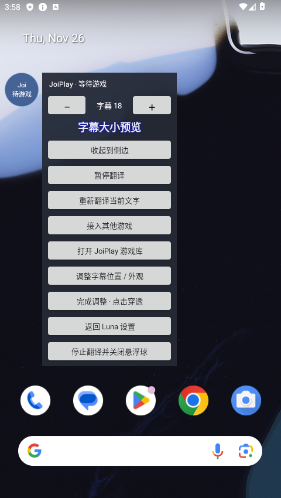

# LunaMobile

**在安卓上玩日文 RPG，游戏对白出现时就能看到中文字幕。**

LunaMobile 会从已接入的 JoiPlay 游戏读取引擎文字，再通过你选择的翻译服务显示悬浮字幕。看剧情时可以快速改字号，继续操作时字幕支持点击穿透；悬浮球可收成贴边的一条淡线。

[下载 Android APK](https://github.com/mch1902879100-cmyk/LunaMobile/releases/tag/v0.6.5-preview) · [反馈游戏兼容性](https://github.com/mch1902879100-cmyk/LunaMobile/issues/new)

## 三步开始

1. 在 Android 8.0 或更新版本上安装 LunaMobile。准备好可正常启动的 JoiPlay 游戏，按该游戏的要求安装 JoiPlay 和相应插件。
2. 在 LunaMobile 里选择翻译服务，点「接入 JoiPlay 游戏」，授权游戏所在文件夹并选择要玩的游戏。接入会在已授权的目录写入取词文件。网页和 RGSS 入口的修改会保留原文件备份。
3. 开启悬浮翻译，再到 JoiPlay 打开或重启游戏。点击悬浮球可以调字号，拖到边上松手可以收起；点淡线附近重新展开。

## 兼容范围

- **已有实际运行样本**：RPG Maker VX Ace、MV、MZ，以及部分 Tyrano 和通用 HTML 游戏。
- **仍在验证**：RPG Maker XP/VX、Ren’Py 的接入代码已有内部检查，具体游戏仍需实测。特殊插件、自绘界面和所有游戏的完整流程尚未覆盖。
- **备选方式**：直接取词不适用时，可以手动开启 OCR。OCR 需要 Android 屏幕共享许可。

游戏、JoiPlay 和插件需自行准备。有接入问题时，反馈游戏引擎、JoiPlay 版本、Android 版本和可公开的复现步骤即可，避免上传存档、密钥或游戏文件。

## 数据和网络

取词和 OCR 识别在设备上运行。需要翻译的文字会发给你选择的翻译服务，请为接口使用可信的 HTTPS 地址。应用设置与翻译历史保存在设备上。打开 OCR 时，Android 会显示屏幕共享授权。

## 从源码构建

需要 JDK 17 或兼容版本、Android SDK 35。设置 ANDROID_HOME，或用 Android Studio 生成 local.properties。在 Windows 运行：

    gradlew.bat testDebugUnitTest assembleDebug

APK 输出在 build/app/outputs/apk/debug/。GitHub 上的 0.6.5-preview 为调试签名的预览安装包。

## 项目关系与许可

LunaMobile 是独立维护的安卓项目，设计参考 [LunaTranslator](https://github.com/HIllya51/LunaTranslator)。项目源码采用 GPL-3.0-or-later，详见 [LICENSE](LICENSE) 和 [NOTICE](NOTICE)。
